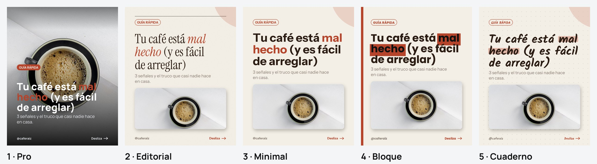

# carrusel-pro

Le dices a Claude **"hazme un carrusel de…"** y te entrevista (tema, marca, estilo, Canva o no), te propone el texto, dibuja las ilustraciones y te entrega las imágenes listas para Instagram o TikTok, con la descripción y los hashtags.

### [⬇️ Descargar carrusel-pro.zip](https://github.com/dakexplica/carrusel-pro/releases/latest/download/carrusel-pro.zip)

Solo esta herramienta, lista para subir a Claude (no la descomprimas).



## Instalar

### En Claude Code (lo más fácil)
Pega esto en Claude Code: *"Instala la skill carrusel-pro con `npx skills add dakexplica/carrusel-pro`. Antes revisa que tenga Node.js, Python 3 y Pillow; si falta algo, pídeme permiso para instalarlo."*

O en la Terminal:

```bash
npx skills add dakexplica/carrusel-pro
```

### En la app de Claude
1. Toca **⬇️ Descargar carrusel-pro.zip** (arriba). Déjalo así, no lo abras.
2. En Claude: tu nombre (abajo a la izquierda) → **Configuración → Capacidades** → enciende **Crear y editar archivos**.
3. **Personalizar → Skills → + → Crear skill → Subir una skill** y elige el .zip.
4. ¡Listo! Abre un chat nuevo y pídele un carrusel.

*(En inglés: Settings → Capabilities → Create and edit files; Customize → Skills → Upload a skill.)*

También puedes usar el botón verde **Code → Download ZIP** de esta página: baja solo esta herramienta.

## Qué trae
- 4 estilos: Editorial, Minimal, Bloque y Cuaderno
- Tu marca: tus colores, tipografía y logo; la saca de tu web, o te inventa una
- Ilustraciones nuevas para cada tema
- Instagram 4:5 y TikTok en modo foto
- Serie de 5 carruseles con calendario
- Descripción + hashtags

## Guía interactiva incluida · 3 pasos · ~5 min

La primera vez que la usas, Claude te pregunta si quieres que te enseñe (puedes decir que no y usarla directo):
1. **Tu primer carrusel** con tu tema (o uno de ejemplo) en 2 minutos.
2. **Con tu marca**: la saca de tu web o tu Instagram, o te inventa una, y aprendes a pedir cambios.
3. **Listo para subir**: Instagram y TikTok, con la descripción y los hashtags.

Ábrela cuando quieras:

> Usando la skill carrusel-pro, empieza la guía

## Pruébala con esto

> Usando la skill carrusel-pro, hazme un carrusel sobre cómo preparar un buen café en casa

Más herramientas gratis: **[dakexplica.derekavelar.com](https://dakexplica.derekavelar.com)** · [github.com/dakexplica](https://github.com/dakexplica)

Hecha por [@dakexplica](https://www.instagram.com/dakexplica). Gratis para usar y compartir.
