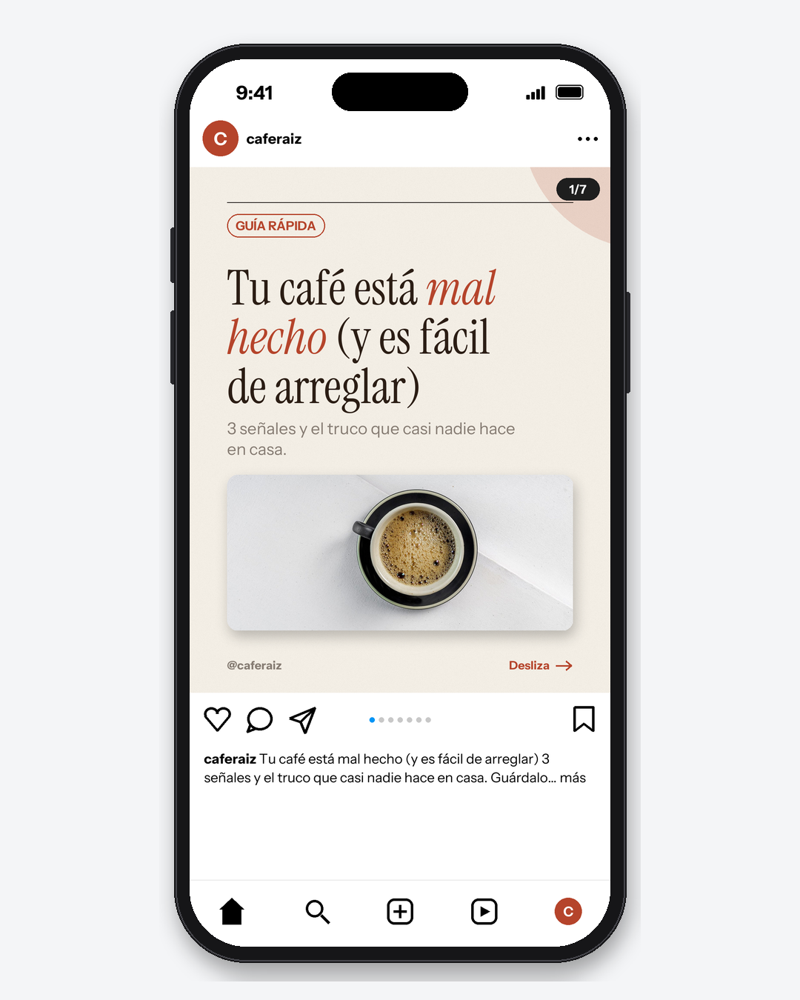

# Carrusel Pro · dak-carrusel-pro

Le dices a Claude **"hazme un carrusel sobre…"** y te entrega un carrusel **con tu marca**, listo para Instagram, TikTok y LinkedIn: el texto de cada lámina, fotos y logos reales, la descripción con hashtags y una vista de cómo se ve ya publicado.

- **Se adapta a tu marca:** le pasas el link de tu página (o una captura de tu perfil de Instagram) y saca tu logo, tus colores, **tu letra** y hasta fotos tuyas; o le dices qué letra quieres y te enseña 3 para elegir. Sin marca, sale un diseño neutro y limpio.
- **Con lo tuyo, aunque esté revuelto:** pásale tus fotos, tu logo, tu letra o tus notas como quieras (una carpeta, arrastradas al chat, un documento o texto pegado) y lo ordena: escribe cada lámina con tus ideas y acomoda cada foto donde mejor queda.
- **Imágenes reales:** fotos libres de uso del tema (con su crédito) y los logos reales de las apps que mencionas.
- **Tu página dentro de un iPhone**, paso a paso, comparaciones, listas, datos con fuente y 4 estilos (Editorial, Minimal, Bloque y Cuaderno).
- **Así se ve publicado:** tu carrusel dentro de un iPhone, en Instagram y en TikTok, antes de subirlo.
- **Instagram (4:5), TikTok (modo foto) y LinkedIn (PDF)** a la vez, cada uno acomodado a su medida.
- Una sola ronda de preguntas y a trabajar. Si tienes **Canva, Adobe Express o Google Drive** conectados, te lo deja ahí también.

Incluye una **mini guía interactiva** de unos 5 minutos (3 pasos): tu primer carrusel, con tu marca, y listo para subir.

### [⬇️ Descargar dak-carrusel-pro.zip](https://github.com/dakexplica/dak-carrusel-pro/releases/latest/download/dak-carrusel-pro.zip)



Hecha por [@dakexplica](https://www.tiktok.com/@dakexplica) · Gratis.

## Lo que necesitas
- **Claude Code** (app de escritorio o terminal) o la **app de Claude** (claude.ai) con "Crear y editar archivos" encendido.
- **Python 3.8 o más nuevo** (viene en Mac) y **Pillow** (la herramienta con la que dibuja las láminas). La skill revisa si los tienes y **te pide permiso** antes de instalar algo.
- Opcional: internet (marca desde tu página, fotos y logos reales), Chrome o Edge (captura de tu página), y Canva, Adobe Express o Google Drive conectados. Sin eso funciona igual.

## Instálala

**Con Claude Code**, pega esto:

```
Instala la skill dakexplica/dak-carrusel-pro con `npx skills add dakexplica/dak-carrusel-pro`, revisa con su Paso 0 si me falta algo (pídeme permiso antes de instalar) y cuando esté lista, pregúntame si quiero la guía.
```

O el comando directo:

```bash
npx skills add dakexplica/dak-carrusel-pro
```

**En la app de Claude:** descarga el `.zip` (arriba), y en Claude: **Configuración → Capacidades** → enciende **Crear y editar archivos**; luego **Personalizar → Skills → + → Subir una skill** y elige el .zip (sin abrirlo).

## Úsala

```
Usando la skill dak-carrusel-pro, hazme un carrusel sobre [tu tema]
```

Con tu marca: *"…con la marca de mipagina.com"*. La guía: **«Usando la skill dak-carrusel-pro, empieza la guía»**.

## Qué es gratis y qué cuesta
La skill es gratis. Las fotos salen de Wikimedia Commons (licencias libres) y los logos de sus fuentes oficiales, sin cuentas ni claves. Canva, Adobe Express y Drive son opcionales y tienen planes gratis. Si haces muchos carruseles al día, un plan de pago de Claude te da más mensajes; no es obligatorio.

## Actualizaciones
Esta skill **no se actualiza sola**, pero te avisa: cuando la usas, mira en silencio (máximo una vez al día) si hay una versión nueva aquí. **Si no la hay, no dice nada.** Si la hay, al final te pregunta si la actualiza; con «ahora no», no vuelve a mencionar esa versión. Nunca descarga nada sin tu permiso. Lo que cambia en cada versión: [CHANGELOG.md](CHANGELOG.md).

## ¿Algo falla?
- **No sacó bien mi marca:** algunas páginas no dejan leerse desde fuera. Mándale una captura de tu página o de tu Instagram, o tus colores.
- **Instagram:** no deja leer perfiles desde fuera (a nadie). Por eso se usa una captura de tu perfil.
- **No sale una foto o un logo:** pásale el tuyo en PNG; o dile que use un dibujo.
- **No publica sola:** a propósito, para no entrar a tu cuenta. En tu celular: Instagram **+ → Publicación → selecciona varias**; TikTok **+ → Fotos**.
- **Quiero la guía otra vez:** «ábreme la guía».

Créditos de la foto del ejemplo: Jubair1985, CC0 (Wikimedia Commons). Tipografías libres (SIL OFL) en `fuentes/`.

Más herramientas gratis: **[dakexplica.derekavelar.com](https://dakexplica.derekavelar.com)** · [github.com/dakexplica](https://github.com/dakexplica)

## Licencia
MIT.
